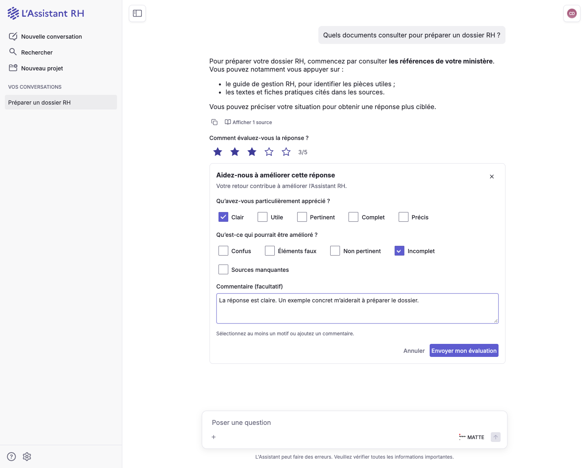

# Évaluation des réponses Assistant RH

Chaque réponse terminée disposant d’une association serveur fiable affiche une note de
1 à 5 étoiles. Le formulaire s’ouvre à la sélection, puis l’envoi reste explicite.
Les anciennes réponses sans association et les réponses encore en cours de génération
ne proposent pas d’évaluation. Le mode Conversations hors Assistant RH conserve ses pouces.

Les composants Cunningham et les couleurs contextuelles héritent du thème actif,
y compris des variantes DSFR et sombres, sans ajouter un second système graphique.

| Note | Motifs disponibles |
| --- | --- |
| 1–2 | Confus, Éléments faux, Non pertinent, Incomplet, Sources manquantes |
| 3–4 | Motifs négatifs et Clair, Utile, Pertinent, Complet, Précis |
| 5 | Clair, Utile, Pertinent, Complet, Précis |

Un motif ou un commentaire non vide est requis. Le commentaire est limité à
4 000 caractères. Changer de note retire les motifs incompatibles. Annuler restaure
l’évaluation enregistrée ; une erreur conserve la saisie. La relecture à la réouverture
permet de modifier une évaluation existante.

## Contrat et stockage

Le navigateur utilise uniquement les routes de session Conversations :

- `GET /api/v1.0/chats/{conversation_id}/messages/{message_id}/feedback/` :
  `200` avec l’évaluation, `204` si aucune évaluation n’existe pour cette réponse.
- `POST` sur la même route : `204` uniquement après confirmation d’enregistrement
  par l’API Assistant RH.

Le corps comprend `stars` (entier 1–5), `reasons_positive` et `reasons_negative`
(tableaux de libellés), et `comment` (chaîne). Aucun identifiant de completion,
d’identité ou de session n’est accepté dans le corps.

Le backend retrouve `AssistantRHMessageRun` à partir de la conversation appartenant
à la personne connectée et du message assistant enregistré. Il vérifie les droits
ministériels actuels et signe une délégation fraîche avant chaque appel à
`POST /v1/feedback` ou `GET /v1/feedback/{completion_id}`. La base URL configurée
contient déjà `/v1`. L’API Assistant RH reste le stockage durable et calcule `helpful`.
Les réponses HTTP ne sont pas mises en cache ; le cache React Query est isolé par
route de message, et toute relecture antérieure est annulée avant de publier un envoi réussi.

## Vérification

Les tests directs du composant exercent les cinq notes, la validation, les changements
de motifs, le clavier, les erreurs et reprises, la modification et les relectures
concurrentes d’un envoi. Les tests de `MessageItem` vérifient le raccordement réel,
la fin de génération et l’absence d’évaluation pour les anciens messages.

Les tests backend vérifient le contrat HTTP, l’identité et les droits courants,
le refus des substitutions, la relecture et les erreurs du service amont.
La recette visuelle locale peut utiliser des réponses API synthétiques ; elle ne
constitue pas une validation d’enregistrement sur l’environnement de staging.

## Aperçu

Captures de l’interface Conversations locale avec des données de démonstration
et des réponses API simulées dans le navigateur.

[Voir la capture mobile](assets/feedback-mobile.png).
